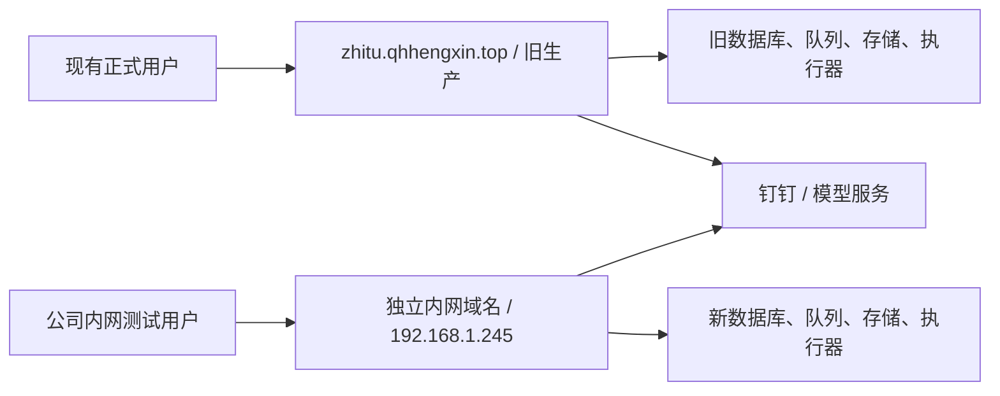

# 恒鑫智图内网生产副本方案 · 2026-11-10

状态：**2026-11-10 用户已确认范围并授权开始复制，实施中**。授权在 `.245` 部署独立内网副本，复制本方案指定代码、权限与 Skills；旧生产只读获取，正式入口不切换。下面各节的“未来实施”描述现作为执行计划，完成与未完成事项以执行记录为准。本文不改变既有产品功能或已完成的开发阶段。

## 1. 用户确认的目标与边界

实施适配补充（新端限定）：真实执行检查发现 Codex 的 Bubblewrap 环境清空普通代理变量。新端两套原生执行代码采用有源文件 SHA-256 校验、备份和独立审查的最小部署补丁：仅显式设置 `HENGXIN_ALLOW_LOOPBACK_CODEX_PROXY=1` 时允许 production 使用通过现有校验的 loopback HTTP(S) 代理，并补充控制字符拒绝。国内、海外 worker 配置 `HENGXIN_CODEX_PROXY_URL=http://127.0.0.1:7890`；保持 `APP_ENV`、用户身份与工具沙箱策略。默认行为不变，远程地址或带凭据的代理仍拒绝。补齐同版本 `codex-code-mode-host` 及包元数据，逐文件校验；不修改旧生产。

在 `192.168.1.245` 建立当前生产的独立副本，先保证公司内网可以使用，前后端功能与当前生产一致。旧生产 `107.172.161.139` 持续运行；两套分别处理自己的数据，内网验收通过后再安排正式域名切换。

“一比一”指当前有效代码、功能、权限语义和必要运行配置一致，不是整机克隆，也不是带走所有历史数据。

| 事项 | 本次复制目标 |
|---|---|
| 国内、海外前后端及执行逻辑 | 完整复建当前已发布功能；保持实际镜像、源码补丁、依赖和执行参数 |
| 海外 Skills | 保留当前文件、发布索引、管理状态、平台分类和相关管理审计 |
| 国内、海外用户 | 保留原身份 UUID、身份绑定、原角色、审批、启停状态及环境变量授权；重新登录，不重新申请权限 |
| Codex 与模型调用 | 保留调用能力和配置；并行使用必须有独立可用授权，不能让两机刷新同一复制令牌 |
| 旧任务、图片、素材、会话、归档、统计、执行历史 | 不复制；新实例业务数据从空开始 |
| Redis 队列、会话、运行锁、旧在途任务 | 不复制；在新端重新建立 |
| 国内 Skills 等已退役模块 | 不恢复；历史代码或存储前缀不代表当前功能 |
| 旧生产服务、入口、DNS、钉钉正式首页 | 此阶段保持；不排空、不停服、不改变旧生产消费者 |
| 正式切换 | 独立后续工作，见第 10 节；不包含在“复制并验证”的执行动作中 |

两套并行不等于实时同步或主从热备。复制之后的人员审批、角色、Skills 更新和业务数据各自变化；不配置双向同步，不把内网试验数据回写生产。

## 2. 依据与当前基线

依据 2026-11-10 已完成的只读盘点：`output/migration-inventory-20261110/恒鑫智图迁移只读盘点清单.txt`，以及同目录 `runtime.json`、`db_inventory.json`、`files_inventory.json`、`dependencies_inventory.json`、`edge_inventory.json`、`final_checks.json`、`unchanged_check.json`。原始证据存放在本地忽略目录，交接时须随受保护交付包保留；本文附录保留逐表处理规则，不能只依赖忽略目录。

生产发布记录：[0.2.67 发布](OVERSEAS-LIGHT-RELEASE-20261107.md)、[国内退役记录](DOMESTIC-RETIREMENT-RELEASE-20261016.md)、[账号管理合同](CODEX-ACCOUNT-MANAGEMENT-20261026.md)。当前执行器与目录原位补丁以实查为准，不能只按 Git 最新提交或目录日期推断。

- 前端 `0.2.67`，发布 `overseas-light-20261107-d7c21a1`；当前发布清单含 688 个 dist 路径，不复制线上长期积累的 26,345 个静态文件。
- 国内数据库 `hengxin`：39 表，迁移版本 `0032`。海外 `hengxin_overseas`：44 表，版本 `overseas_0026`。
- PostgreSQL 16.15、Redis 8.8、MinIO `RELEASE.2025-09-07T16-13-09Z`、前端 nginx 1.27-alpine，使用盘点得到的实际镜像摘要锁定；应用镜像也锁实际 ID，不拉取 `latest` 替代。
- 原生国内、海外 Worker 均实际执行 Codex `0.162.1`，各并发 5；不采信旧 API 环境字段中的 `0.156.1`。
- 源机 Python 3.12.3；代码约束 Python 3.12，前端当前工具链 Node 24.18.1 / pnpm 10.33.4，依赖按锁文件复建。本次不借复制之机升级框架或数据库。
- 新机此前确认 Ubuntu 24.04.5、10 vCPU、约 16 GiB RAM、2 TiB 磁盘。存在 XSAVE 警告、未暴露 AVX/AVX2；同版 Codex、沙箱与实际负载兼容性必须先验，尚未通过本次验证。
- `202.96.165.231` 只是此前测得的直连出口；没有证明固定公网地址或入站 NAT 可用。内网副本不依赖公网入站。

本次盘点计数是运行中分时观测，不是冻结快照。实施时重新记录版本与白名单数据摘要，接受有解释的新增审批或 Skills 变更，不拿旧计数硬覆盖生产现状。

## 3. 双套部署与访问设计

### 3.1 推荐内网入口

**2026-11-11 后续最新用户明确选择像恒鑫智邮一样的 IP 加端口访问：`http://192.168.1.245:8080`。下述公司 DNS 方案停止实施，未修改路由器/DNS；改按 [内网 IP 访问合同](INTRANET-IP-ACCESS-20261111.md) 实施。**

**2026-11-11 最新授权覆盖下述临时测试范围：公司内网统一使用 `https://zhitu.qhhengxin.top/` 访问 `192.168.1.245`。通过公司 DNS 精确覆盖该主机名，并由现有 DHCP/网络管理配置分发有效的内网 DNS；公网解析和旧生产服务保持不变。独立浏览器启动器仅为此前技术验证工具，不作为公司日常访问方案。**

实施顺序及完成标准：

1. 确认公司网关/DHCP/DNS 管理入口与实际网段，保存将修改的现有设置；不新建竞争 DHCP 服务。
2. 优先使用现有网关的静态 DNS 能力；需要独立 DNS 时只监听受控内网地址、限定公司来源，并保持其他域名正常递归解析。精确处理本站 A/AAAA，避免客户端落到公网旧实例。
3. 由公司现有 DHCP 分发能解析本站的 DNS，检查代理和加密 DNS 对客户端解析的影响；不以单机 hosts 或仅创建 DNS 记录作为全公司完成依据。
4. 从正常公司客户端验证域名解析为 `.245`、可信 HTTPS、响应环境为 `lan-245`，再验证钉钉回调。公网 DNS 仍解析旧服务器，其他网站解析保持正常。记录实际验证设备和未覆盖范围。

当前调查：办公电脑 `192.168.3.104` 的 DHCP/网关为 `192.168.2.1`，下发 DNS 为 `223.5.5.5`、`114.114.114.114`。`.245` 尚无监听内网的 DNS 服务。已尝试网关 HTTP 管理入口，连接超时；等待公司实际管理后台入口，尚未修改公司 DNS/DHCP 设置。

以下为 2026-11-10 的历史临时方案，访问范围以上述最新授权为准。

**2026-11-10 执行中用户指定继续使用 `https://zhitu.qhhengxin.top/`。当前主方案改为：新端使用同一正式域名与回调 URL，公网 DNS 保持旧生产；仅指定测试终端/独立浏览器通过受控解析访问 `.245`，避免共享浏览器会话混用。不修改全公司正式解析。旧证书目前仅覆盖正式名，可受保护复制到新端使用，续期需在正式切换前单独安排。** 下列独立测试子域名方案仅保留为备选，不创建该子域名或追加其回调。

原备选测试主机名 `zhitu-lan.qhhengxin.top` 尚未创建、未检查名称占用、未申请证书。

1. 公司 DNS 将该测试名解析到 `192.168.1.245`；首轮可只给指定测试电脑配置 hosts，手机验收使用公司 Wi-Fi 的 DNS。保留正式名原解析，不覆盖全公司正式域名。
2. 新机提供可信 HTTPS 443；80 仅用于跳转或按需要关闭。通过 DNS-01 为受控测试域名申请证书，无需新机对公网开放 80/443。DNS-01 仍需域名管理权限，证书和续期凭据只放受限目录。[Let’s Encrypt 官方说明](https://letsencrypt.org/docs/challenge-types/)
3. `http://192.168.1.245:18080` 只适合受限技术探测，不作为完整钉钉登录、Secure Cookie 和浏览器功能验收入口。
4. 新入口仅允许已确认的公司网段；`.245` 双网卡的管理、业务与出网路径分别核验。先检查实际网段和 Docker 转发规则，不直接把所有私网或 0.0.0.0 都放开。容器数据库、Redis、MinIO 控制台只在 loopback/内部网络可达。
5. 新旧不同 origin，浏览器会话与缓存自然分开；允许同一个人同时打开正式页和内网页。提示测试人员这是独立数据环境，可在内网入口页签或运维说明标明环境，业务页面逻辑保持一致。

**备选：指定测试终端对正式名做 hosts/split DNS 指向 `.245`。** 可以复用正式回调名，但同一个浏览器配置文件不能安全地在两端来回切：Cookie、登录 state 和缓存可能错配；必须使用独立浏览器配置和受控 DNS，手机还要专用解析。只在无法增加测试回调时采用；不把它当作两套日常同时访问的首选。

### 3.2 服务复建清单

| 部分 | 必须复建的当前服务 |
|---|---|
| 国内 9 容器 | `api`、`outbox`、`api-image-outbox`、`api-image-worker`、`image-variants`、`web`、`postgres`、`redis`、`minio` |
| 海外 5 容器 | `api`、`skill-publisher`、`overseas-postgres`、`overseas-redis`、`overseas-minio` |
| 身份 2 容器 | `identity-api`、`identity-redis` |
| 国内原生服务 | `hengxin-vps-codex-worker`、`hengxin-domestic-deletions`、`hengxin-retention` |
| 海外原生服务 | `hengxin-overseas-worker`、`hengxin-overseas-outbox` |
| 授权原生服务 | `hengxin-codex-accounts`、`hengxin-codex-auth`（现行兼容服务，不擅自删除） |
| 新机 HTTPS | 本站独立反向代理、证书续期；不复制整个 1Panel 或其他站点 |

新 Compose 项目名使用 `hengxin-lan-domestic`、`hengxin-lan-overseas`、`hengxin-lan-identity`；显式指定 volumes/networks，消除历史 Compose 名称的误关联。内部端口可保持现有 18008/18018/18012/18080 与 15433/15443 等布局，但须先检查新机冲突。端口不空闲时先调整配置映射，不终止未知进程。

统一新前端代理全部三组接口：`/api/identity/v1`、`/api/overseas/v1`、国内 `/api/`。保留 HTTPS origin、Host、转发协议、上传大小、SSE 和超时语义；尤其海外 500 MB 单附件的请求余量，不用国内 10m 限制覆盖海外。配置以线上有效路由为基线；验证外层和内层代理两层限制。[nginx 代理参数](https://nginx.org/en/docs/http/ngx_http_proxy_module.html)

## 4. 代码、配置与文件交付

### 4.1 运行代码不能只复制仓库目录

交付包包括：当前正式前端完整资源、16 容器所用唯一镜像集合及摘要、应用源代码与锁文件、数据库完整迁移链、以下实际原生代码根及原位补丁。

| 源机实际路径 | 用途与处理 |
|---|---|
| `/opt/hengxin-native-releases/domestic-record-filters-20261022-2f08f8f/backend` | 国内执行与清理服务的当前代码 |
| `/opt/hengxin-overseas-releases/overseas-20261024-b6289eb/backend` | 海外 Worker/outbox 当前代码，含后续补丁 |
| `/opt/hengxin-account-releases/account-management-20261026-ce4baf4/daemon` | 当前独立账号管理服务 |
| `/opt/hengxin-native-releases/domestic-codex-auth-20261019/backend` | 仍运行的兼容授权服务 |
| `/opt/hengxin-runtime/codex-0.162.1/codex`、`/opt/hengxin-runtime/bwrap` | 锁定实际运行时，校验内容与新机执行能力 |
| `/etc/apparmor.d/hengxin-codex-userns`、`hengxin-codex-0.156.1`、`hengxin-task-isolation` | 按实际生效路径验证沙箱规则；名字含旧版本不代表无效 |

每个文件清单记录相对路径、类型、长度、SHA-256、权限及安全链接目标。新机保留必要路径或显式修改所有引用，禁止只改 systemd 的 WorkingDirectory 留下内部绝对路径。虚拟环境按锁文件在新机重建，不照搬带旧路径的 `.venv`。

旧机不安装新工具、不建中转归档、不更新访问凭据。后续获准实施复制时，通过既有只读连接流式取得镜像/所需文件，输出落本地受保护目录或新机；设置限速和超时，避免阻塞生产。读取并不代表绝对零开销，遇到负载异常暂停复制。

### 4.2 等效配置与环境隔离

从最终运行配置整理有效值及来源，合并多层 Compose 和 systemd drop-in；逐项标记“保持”“新环境替换”“不迁移”。核对模型、并发、重试、限流、角色名单、定时清理策略、路径和挂载。不能仅用最早 `.env` 或重新执行历次发布脚本。

- 新端重新生成 DB/MinIO 密码、身份服务内部密钥；国内/海外内部密钥各自独立并成套接线。外部钉钉企业/应用身份与模型配置另行受保护交付，不打印秘密。
- `codex` 原 UID 1001、海外服务原 UID 999、API UID 10001、授权组及 socket 权限逐项检查新机冲突。新机 mihomo 已占 999；调整该系统账户的操作被自动审批拦截，未执行。保留 VPN 不动，海外服务用空闲 UID 1002，授权 broker 在新端增加明确的执行器 UID 参数（默认仍为生产 1001/999），配置新端 1001/1002；保持 SO_PEERCRED 业务隔离，记录这一部署适配差异并单独审查测试。
- `/run/hengxin-codex-accounts`、`/run/hengxin-codex-auth`、`/run/hengxin-skill-publisher` 由服务新建，不能复制旧 socket/PID/锁文件。
- 执行目录、临时上传、图片缓存、日志从空开始；API、publisher、宿主机 worker 的共享路径必须指向同一份新端目录。先用新端测试文件验证映射，再启动清理器。
- 在新端连接配置中禁止出现旧生产 DB、Redis、MinIO、broker、执行目录远程挂载。允许旧 IP 作为现有 VPN 外部依赖，不能用简单禁止该 IP 替代逐用途审核。
- 不直接开启指向旧环境的备份、自动发布、定时清理或运维脚本；所有自动任务明确只操作新端。新数据的保留策略沿用当前产品行为。

## 5. 选择性数据复制

### 5.1 保留白名单

| 国内表 | 盘点行数 |
|---|---:|
| `users` / `user_identities` / `role_assignments` | 30 / 29 / 23 |
| `domestic_membership_applications` / `domestic_membership_application_events` / `domestic_member_audits` | 2 / 4 / 2 |
| `system_settings` / `settings_audit` | 1 / 2 |

国内 30 名录是 25 active、4 pending、1 disabled；完整保留这些目录记录是为保持身份及权限语义，不能把所有记录都开通。已批准者无需再审批。

| 海外表 | 盘点行数 |
|---|---:|
| `overseas_members` / `overseas_member_roles` | 8 / 8 |
| `overseas_membership_applications` / `overseas_membership_application_events` / `overseas_member_audits` | 6 / 12 / 11 |
| `overseas_settings` / `overseas_installed_skill_availability` | 1 / 24 |
| `overseas_management_audit` | 仅保留 skill.* 相关 48 条；排除 studio.* 4 条 |

Skills 审计按字段复核 JSON，只保留技能管理必要信息，不因审计引用旧任务 ID 就连带复制旧任务。需要删去历史业务正文时，记录字段变换和计数；不能悄悄篡改审计语义。

还要保留数据库之外的授权：国内管理员名单 2 项，海外 Skills 操作者 1 项、额外全权限成员 1 项、工作流协作者 5 项；特别是 `/etc/hengxin-overseas/workflow-collaborators.env`。保留身份 UUID 与这些配置的关系。

其余 83 表的处理见附录：保留结构，旧业务记录不导入；运行门闩/渠道状态按新实例初始化，不继承旧租约和暂停状态。三个 Redis 空建；两个 MinIO 建新桶和策略，不复制旧业务对象。不要“整库恢复后再删业务数据”，也不能只写 alembic 版本号冒充迁移成功。

### 5.2 不停旧生产的复制一致性

1. 新端消费者先不启动。对每个源库使用独立 `REPEATABLE READ READ ONLY` 事务，按白名单显式列导出，记录版本、计数、主键集合和排序后的内容摘要。不是逐表各取一个随机时间点；长事务设限，生产 DDL/超时冲突则退出重试。[PostgreSQL 事务隔离](https://www.postgresql.org/docs/16/transaction-iso.html)
2. 两个数据库和文件树没有天然同一事务快照。先读取 Skills current 指针、发布清单、状态摘要，复制所需不可变文件及索引，再核对指针/文件摘要/数据库状态没有变化；变化则舍弃该批候选并重新获取。跨库身份与配置也做前后摘要及引用核对。记录各库快照时刻，不宣称全局原子快照。
3. 如果旧端持续更新或清理导致无法取得一致 Skills 包，暂停本次复制、择时重试；此阶段不能为取快照锁死或停止旧生产。
4. 新端通过当前完整迁移链建立两个空库，按真实 FK 依赖排序导入，保留 UUID、状态、时间语义，修正需要的序列。检查全部 FK/唯一约束，并核对 JSON、配置和文件引用。
5. 在消费者启动前验明白名单数据相同、禁止表为空、对象桶为空、无待投递旧消息。结果进入基线清单；随后新增测试数据是正常的，不能再要求整库一直为空。
6. 中断导入只回滚或重建未开放的新端候选库，不重跑脚本覆盖已被测试人员使用的实例。复制后生产新增角色/技能不自动覆盖内网，后续刷新走差异报告和明确合并策略。

### 5.3 海外 Skills 文件

完整复制 `/var/lib/hengxin-overseas/local-skills/` 的 `current.json`、`releases/`、`packages/`，包括资源、字体、脚本与引用；盘点共 726 文件、765,250,423 字节（约 729.80 MiB）。当前启用 11 项、697 文件、约 725.59 MiB，另 13 条停用状态保留但不恢复已删除实体。

当前 11 项：

1. `amazon-beleev-aplus-design-dept`
2. `amazon-beleev-main-image-design-dept`
3. `amazon-new-product-aplus`
4. `amazon-new-product-image-set`
5. `amazon-outon-image-brief-to-prompts`
6. `homedepot-outon-outonlife-main-image-design-dept`
7. `outon-brand-image-design-version-1023-night`
8. `overseas-brand-image-set`
9. `overseas-multi-platform-product-and-color-replacement`
10. `walmart-outon-outonlife-outdoor-main-image-and-aplus-design-dept`
11. `wayfair-outon-outonlife-image-design`

实施复制时逐文件 SHA-256 对比、校验路径安全和执行位。之前盘点只验证清单 hash、文件存在和尺寸，不能替代这次完整字节校验。旧 `skill-transfers` 上传状态与锁不复制；旧空目录和非活动 volume 不当作数据源。

## 6. 钉钉登录：先增加内网测试能力，后切正式入口

当前代码在 `backend/app/identity/router.py` 明确使用共享身份服务回调：

- 旧正式：`https://zhitu.qhhengxin.top/api/identity/v1/dingtalk/callback`
- 内网候选：`https://zhitu-lan.qhhengxin.top/api/identity/v1/dingtalk/callback`

当前执行方案沿用第一条正式回调 URL；指定测试浏览器的域名解析确保授权发起与返回都到 `.245`。本轮不新增测试子域名回调，不更改钉钉正式首页。新端实际出口仍需验证是否满足现有白名单。

不能照历史文档误用 `/api/v1/auth/dingtalk/callback`。回调含 state Cookie 和新端 Redis 校验，授权发起与回调必须回到同一环境；不能让旧身份服务代收新登录再盲转 code。

| 项目 | 内网复制阶段 | 后续正式切换 |
|---|---|---|
| 钉钉企业/应用标识 | 优先沿用现有企业与应用以保持用户身份映射 | 保持，同步确认权限范围 |
| 登录回调、安全域名 | 查控制台是否支持保留旧项并追加测试项；只追加、不覆盖旧项 | 正式回调保持原 URL；测试项按是否保留内网环境决定 |
| 正式工作台首页 | 保持指向旧生产 | 验收后才切其访问目标；若正式 URL 不变则首页无需改字面值 |
| 新端 public origin | 身份与两业务都一致指向测试 HTTPS origin | 三者同时切到正式 HTTPS origin |
| 服务端出口白名单 | 先测真实 identity 容器的钉钉出站 IP；如需增加则保留原项 | 按最终线路保留必要出口，稳定前不删旧项 |
| 浏览器、PC/手机钉钉 | 从内网测试链接发起完整登录；正式应用入口仍到旧端 | 再验正式入口全链路 |

安全设置中的服务器出口 IP 和登录回调是不同配置；官方接入文档分别要求配置调用服务端 API 的出口及回调地址。控制台具体字段、多回调能力与应用当前授权需实施前核实，现有盘点没有登录控制台。[阿里云官方钉钉接入步骤](https://help.aliyun.com/zh/sase/use-cases/use-sase-to-ensure-security-access-for-dingtaik-users)

新端必须统一 `IDENTITY_PUBLIC_ORIGIN` 与海外 `OVERSEAS_IDENTITY_PUBLIC_ORIGIN`，并核对国内配置；内部 identity URL 指向新端身份容器。保持 HTTPS、SameSite/HttpOnly Cookie、同源检查和独立内部服务密钥。

网页登录的 OAuth 返回由用户浏览器访问回调：用户设备能解析和连接内网站点、服务器能调用钉钉 API 是必要条件；这不等于所有钉钉能力都不需要公网入站。若另有服务端事件推送/URL 验证，单独盘点，不把网页登录回调当成 webhook；不能无依据声称已完成端内登录验证。

如果当前钉钉应用不允许并存测试回调，优先采用第 3 节的受控测试终端方案完成既有应用登录测试；再评估同企业专用测试应用。使用测试应用必须实测 unionId/corpId/userId 映射保持原授权，不能通过重置用户 ID 或自动授权绕开。任何需要替换正式回调或正式首页的操作都不属于此阶段。

## 7. 两套同时运行的 Codex 与外部调用

**用户权限数据可以复制，OAuth 刷新令牌不能简单克隆后两机共用。** 旧机当前两业务分别绑定 `/home/codex/account-management/{domestic,overseas}/state.json` 所引用的 grants；路径分开不证明是不同外部账号。

推荐并行方案：在新端账号管理页，为国内、海外分别建立新环境专用的授权会话，保留旧机绑定和令牌文件不动。优先使用独立测试账号；如必须沿用同一外部账号/工作区，由账号持有人完成新的授权，并验证新旧会话都可用、刷新互不影响及额度允许。不同登录产生的会话是否完全独立是验收项，不作先验保证。

- 新端不导入旧 grant 后自动启动刷新，不导入旧 state 的 ready 状态伪装已验证。新授权验证成功再绑定；当前存在独立设备授权流程，可复用现行账号管理能力。
- 不执行旧机 logout/revoke/remove/check；其中 check 会发真实请求并修改状态，不是只读探测。新授权可能需要持有人交互，这不是重新审批智图用户权限。
- 若只能提供同一份旧 refresh token 且无法建立独立会话，则 UI、DB、Skills 等可继续验，但 Codex 全功能并行验收不能通过；不能偷改成暂停旧生产来满足复制目标。
- 不共用两台机器上的令牌文件锁，也不临时暴露旧 broker 给新机；跨机共享授权服务属于另一个架构变更。
- 模型网关 `api.qhhengxin.top` 是外部服务（盘点解析到 `154.36.185.222`），保留调用地址/模型参数。若用同一 API key，两套可能共享额度/限流；优先同项目独立测试 key，否则设置明确测试调用上限并标记用量。真实付费请求在实施时确认预算，不能拿 401/健康接口代替生成成功。

## 8. 新机网络、代理与自动启动

已有 Mihomo 规则分流保持。shell/APT 已设置不代表 Docker、容器和 systemd 自动使用代理；Docker daemon 拉镜像需要独立代理配置。[Docker 官方代理说明](https://docs.docker.com/engine/daemon/proxy/)

- Docker daemon、原生 worker 可使用宿主机 `127.0.0.1:7890`；容器里的同地址是容器自身。为需要出网的容器设计仅 Docker 专用桥可达的宿主机代理入口，限制源网段/接口，禁止开放到全公司或公网。
- 明确 HTTP_PROXY/HTTPS_PROXY/NO_PROXY 及客户端实际支持情况。内部 DB/Redis/MinIO/identity/publisher、loopback、内网服务必须直连；钉钉 API 路由需实测并固定符合白名单的出口，不能只测登录 shell 的公网 IP。
- 检查 DNS、NTP、证书链和模型域名连接；同一请求分别从 identity、API、原生 worker 的真实运行身份发起，区分网络成功、鉴权成功、业务成功。
- 当前 VPN 节点 `node5.qhhengxin.top` 与代理出口均依赖旧机 `107.172.161.139`，旧机继续保留。新旧应用数据独立不代表海外出网基础设施独立。
- systemd、Docker restart policy、数据库就绪、授权 socket、代理和 worker 依赖顺序明确；服务异常要重试和显示故障，不能只靠开机延时。
- 最终安排一次**新机**重启验证：内网 HTTPS、登录、Skills、执行、分流均恢复；旧机不重启。重启前保存新端任务与存储证据，不能只看服务为 active。

## 9. 实施顺序、交付文件与完成门槛

以下为未来实施工作，路径均为**计划创建**，本轮没有生成或执行脚本。代码目录统一位于仓库子目录 `hengxin-smart-image/`；交付文档在根 `docs/`。实施开始前把获准范围链接到 DEV-PLAN，已完成阶段保持原状。

| 顺序 | 目标与动作 | 计划交付文件 | 完成门槛 |
|---|---|---|---|
| 1 基线固定 | 复核当前版本、有效配置和代码；只读获取所需文件，拒绝旧历史包覆盖新代码 | `infra/lan-245/baseline.json`、`config-map.json`、`scripts/migration245/collect_readonly.py` | 16 容器/7 原生来源齐全；秘密不入普通包；旧服务未被操作 |
| 2 主机预检 | 检查端口、UID、磁盘、网卡/路由、DNS/时间；实跑目标二进制与沙箱最小命令 | `scripts/migration245/preflight.py`、`infra/lan-245/systemd/` | Codex 0.162.1 和 bwrap 以真实服务身份运行；无非法指令/沙箱拒绝；缺项明确阻止后续执行 |
| 3 隔离基础设施 | 创建新端专用网络/卷/账号；整合配置，先起 DB/Redis/MinIO/代理 | `infra/lan-245/compose.yaml`、`nginx.conf`、`env.example` | 内部连接全指向新端；数据端口不对非授权网络开放；代理可达且不变开放代理 |
| 4 数据与 Skills | 空库走迁移链；白名单一致性复制、文件全 hash、导入幂等/失败回滚 | `scripts/migration245/export_allowlist.py`、`import_allowlist.py`、`verify_manifest.py` | 83 表结构版本正确；身份和 11 当前 Skills 一致；不带旧业务/会话/队列 |
| 5 内网登录 | 完成测试 DNS/HTTPS，核对并追加允许项，接通共享身份与两业务 | `infra/lan-245/identity-map.json`、`docs/INTRANET-245-ACCESS-RECORD.md` | 真实用户登录；已批准权限可用，停用/待审批保持受限；正式入口未改 |
| 6 执行授权与启动 | 新端独立授权，验证 broker/socket、模型接口、publisher，再开 worker/清理器 | `infra/lan-245/systemd/`、`docs/INTRANET-245-RUNTIME-RECORD.md` | 新端任务只由新端消费；无旧令牌双刷新；新端路径/权限正确 |
| 7 全功能与并行验收 | 按配套清单完成浏览器、接口、真实执行、故障恢复和跨环境隔离 | `scripts/migration245/verify_isolation.py`、`docs/INTRANET-245-RESULTS.md` | 每项有证据；失败修复重验；不把模拟和健康探测标成真实生成通过 |
| 8 内网交付 | 备份恢复演练、新机重启、连续运行观察与用户试用 | `docs/INTRANET-245-HANDOVER.md`、受保护恢复清单 | 内网可长期使用，两套独立并行，剩余外部依赖清楚；仍不切正式域名 |

依赖：1→2→3→4；5 依赖 3/4，6 依赖 2/4/5；7→8。证书和控制台能力核对可以在基础设施准备时并行，只读核对不代表已授权修改外部配置。

每个实施单元按项目规则完成代码审查、必要测试覆盖、编译/构建和真实功能验证；若新增复制/部署脚本，按候选快照执行独立审查后才运行。计划建议最终观察不少于一个正常工作日，并包含一次新机重启；观察期不是跳过未通过项的理由。

部署凭据与数据包只放受保护工作目录，例如新机 `/var/lib/hengxin-migration/lan-245/`（0700），env/令牌 0600，不进 Git、聊天、截图或公开日志。报告仅记录摘要、状态和必要路径；交付验证后删除不再需要的敏感中转副本，执行前核实明确范围，不清理原机文件。

## 10. 后续正式切换预案（不在当前复制阶段执行）

### 10.1 先确定切换时哪份数据有效

旧端继续生产会新增权限与 Skills；新端试用也会产生数据。正式切换前必须制作双方差异报告，不直接把第一次复制当作最新状态。

- 内网只做测试时：默认以切换时旧端的身份/授权/Skills 为准，重新建立干净候选数据；保留测试包备查，明确确认后才清理测试数据。旧业务历史仍按原约定不迁移。
- 内网已用于真实业务时：保留这些新端真实数据；不得清空或整库覆盖。先定义逐表权限合并、Skills 版本选择和 UUID 冲突处理，完成演练后切换；不能自动把新端全部当测试删除。
- 旧端在途任务可自然完成，不强行搬移；何时停止旧端接收新任务是未来切换窗口的动作。当前复制阶段绝不执行。

### 10.2 正式入口选择

| 未来目标 | 切换方式 | 前置条件与回退 |
|---|---|---|
| 仅公司内网使用正式名 | 公司 DNS 将 `zhitu.qhhengxin.top` 指向 `.245`；公网旧解析按保留策略处理 | 新机正式名证书、客户端 DNS/缓存验证；明确外网仍到旧端的行为，避免误写旧环境 |
| 保留内外网访问、继续借旧公网入口 | 旧公网反代通过受限隧道连新机，统一全部业务路由 | 未来需要改旧机代理/隧道配置；TLS/SSE/上传验证；不作为当前内网副本前提 |
| 完全迁出旧公网入口 | 将正式 DNS 指向经验证的新公网入口/NAT/网关 | 证明公网入站、证书、80/443/防火墙和稳定性；不能直接把公网记录改为 `192.168.1.245` 或未经核实的出口 IP |

当前无需决定公网方案或购买服务。DNS 改动应先导出原记录/TTL，提前至少一个原 TTL 降低 TTL（平台支持时建议 300 秒），并同时核对 A/AAAA、CDN 与内网解析。DNS 切换无法保证所有客户端瞬间转移；过渡期间避免两端同时接收同一正式入口的新业务，必要时旧入口维护提示或统一转发，而不是自动按故障回落到另一套数据库。

### 10.3 切换步骤与回退

1. 复核版本差异、数据取舍、正式入口模式、真实回调/出口白名单、备份恢复结果和操作窗口；另行确认正式切换动作。
2. 保护双方数据，完成最终白名单/Skills 差异处理；如需要限制旧端写入，在未来窗口明确范围与恢复方法。不假设数据自动同步。
3. 新端证书/public origin/身份服务/国内/海外同步改为正式入口；保留旧回调允许项与出口白名单直到确认无需回退。正式回调仍是 `/api/identity/v1/dingtalk/callback`，域名没换则 URL 字面值不变。
4. 一次性切整套前端、身份和两业务，不混接新前端与旧 API。用干净浏览器重新登录，两业务生成/下载/Skills/权限冒烟通过才开放正常使用。
5. 开放新业务前失败：恢复入口和新端配置，旧端继续使用；无需恢复旧数据库，因为本次不覆盖旧库。
6. 开放后已在新端产生真实数据：先限制新写入并保全新数据；优先修复新环境。回旧端前明确新数据如何保留/补入，不能只改 DNS 后丢弃新任务，也不能承诺未设计同步的零数据损失回退。
7. Codex 使用各端独立会话时，各端保留自己授权；任何计划从一端转移唯一授权的动作都需先停止对应刷新方并校验最新有效凭据，不能用陈旧令牌备份覆盖新状态。
8. 旧服务器保留到业务验收和依赖替换完成。即使应用切走，VPN 节点仍依赖旧机，不能直接关机、重装或退租。

## 11. 本次方案验收结论

本轮交付的是可执行的计划及[逐项验收清单](INTRANET-245-ACCEPTANCE-20261110.md)。目前没有任何“内网部署完成/登录通过/模型生成通过/可正式切换”的结论。执行准备的关键门槛为：新机二进制兼容、内网 HTTPS 与钉钉登录路径、独立 Codex 授权、完整配置来源和白名单一致性包。

待实施时按本计划先做新端复制和内网验收；正式域名切换单独安排。用户后续明确的执行授权才能启动相应操作，不把本轮讨论写成已部署状态。

## 附录 A：83 张表处理基线

以下自动整理自已完成的只读盘点，行数仅用于解释初始范围；正式导入以当次一致性包为准。

### 数据库 hengxin

| 表 | 盘点行数 | 处理规则 |
|---|---:|---|
| `alembic_version` | 1行 | 通过原项目迁移链初始化至相同版本，不单独复制版本号冒充建表完成 |
| `api_edit_conversations` | 308行 | 不迁移原记录：业务历史、产物、草稿、执行队列、统计、心跳或清理运行状态；保留现行表结构 |
| `api_edit_events` | 0行 | 不迁移原记录：业务历史、产物、草稿、执行队列、统计、心跳或清理运行状态；保留现行表结构 |
| `api_edit_turns` | 0行 | 不迁移原记录：业务历史、产物、草稿、执行队列、统计、心跳或清理运行状态；保留现行表结构 |
| `api_image_attempts` | 2142行 | 不迁移原记录：业务历史、产物、草稿、执行队列、统计、心跳或清理运行状态；保留现行表结构 |
| `api_image_channel` | 1行 | 初始化新实例默认运行状态；不继承旧租约、占用、暂停及在途任务指针；策略来自保留配置 |
| `api_image_dispatch` | 180行 | 不迁移原记录：业务历史、产物、草稿、执行队列、统计、心跳或清理运行状态；保留现行表结构 |
| `api_image_files` | 3332行 | 不迁移原记录：业务历史、产物、草稿、执行队列、统计、心跳或清理运行状态；保留现行表结构 |
| `api_image_items` | 1125行 | 不迁移原记录：业务历史、产物、草稿、执行队列、统计、心跳或清理运行状态；保留现行表结构 |
| `api_image_operations` | 1122行 | 不迁移原记录：业务历史、产物、草稿、执行队列、统计、心跳或清理运行状态；保留现行表结构 |
| `api_image_tasks` | 180行 | 不迁移原记录：业务历史、产物、草稿、执行队列、统计、心跳或清理运行状态；保留现行表结构 |
| `api_image_versions` | 1463行 | 不迁移原记录：业务历史、产物、草稿、执行队列、统计、心跳或清理运行状态；保留现行表结构 |
| `api_task_deletions` | 24行 | 不迁移原记录：业务历史、产物、草稿、执行队列、统计、心跳或清理运行状态；保留现行表结构 |
| `api_usage_facts` | 5998行 | 不迁移原记录：业务历史、产物、草稿、执行队列、统计、心跳或清理运行状态；保留现行表结构 |
| `api_worker_heartbeats` | 8行 | 不迁移原记录：业务历史、产物、草稿、执行队列、统计、心跳或清理运行状态；保留现行表结构 |
| `auth_login_states` | 153行 | 不迁移：旧登录态/临时登录挑战；新服务器重新登录 |
| `auth_sessions` | 412行 | 不迁移：旧登录态/临时登录挑战；新服务器重新登录 |
| `capacity_gate` | 1行 | 初始化新实例默认运行状态；不继承旧租约、占用、暂停及在途任务指针；策略来自保留配置 |
| `capacity_reservations` | 0行 | 不迁移原记录：业务历史、产物、草稿、执行队列、统计、心跳或清理运行状态；保留现行表结构 |
| `cli_retention` | 308行 | 不迁移原记录：业务历史、产物、草稿、执行队列、统计、心跳或清理运行状态；保留现行表结构 |
| `cli_retention_object_links` | 0行 | 不迁移原记录：业务历史、产物、草稿、执行队列、统计、心跳或清理运行状态；保留现行表结构 |
| `cli_retention_objects` | 0行 | 不迁移原记录：业务历史、产物、草稿、执行队列、统计、心跳或清理运行状态；保留现行表结构 |
| `cli_retention_records` | 591行 | 不迁移原记录：业务历史、产物、草稿、执行队列、统计、心跳或清理运行状态；保留现行表结构 |
| `cli_retention_runs` | 480行 | 不迁移原记录：业务历史、产物、草稿、执行队列、统计、心跳或清理运行状态；保留现行表结构 |
| `cli_retention_service` | 1行 | 初始化新实例默认运行状态；不继承旧租约、占用、暂停及在途任务指针；策略来自保留配置 |
| `cli_retention_totals` | 1行 | 不迁移原记录：业务历史、产物、草稿、执行队列、统计、心跳或清理运行状态；保留现行表结构 |
| `domestic_member_audits` | 2行 | 保留：身份/授权/配置及其审计；原状态与关联ID保持 |
| `domestic_membership_application_events` | 4行 | 保留：身份/授权/配置及其审计；原状态与关联ID保持 |
| `domestic_membership_applications` | 2行 | 保留：身份/授权/配置及其审计；原状态与关联ID保持 |
| `execution_gate` | 1行 | 初始化新实例默认运行状态；不继承旧租约、占用、暂停及在途任务指针；策略来自保留配置 |
| `image_variants` | 3324行 | 不迁移原记录：业务历史、产物、草稿、执行队列、统计、心跳或清理运行状态；保留现行表结构 |
| `job_outbox` | 0行 | 不迁移原记录：业务历史、产物、草稿、执行队列、统计、心跳或清理运行状态；保留现行表结构 |
| `job_records` | 0行 | 不迁移原记录：业务历史、产物、草稿、执行队列、统计、心跳或清理运行状态；保留现行表结构 |
| `role_assignments` | 23行 | 保留：身份/授权/配置及其审计；原状态与关联ID保持 |
| `settings_audit` | 2行 | 保留：身份/授权/配置及其审计；原状态与关联ID保持 |
| `system_settings` | 1行 | 保留：身份/授权/配置及其审计；原状态与关联ID保持 |
| `user_identities` | 29行 | 保留：身份/授权/配置及其审计；原状态与关联ID保持 |
| `users` | 30行 | 保留：身份/授权/配置及其审计；原状态与关联ID保持 |
| `worker_heartbeats` | 1行 | 不迁移原记录：业务历史、产物、草稿、执行队列、统计、心跳或清理运行状态；保留现行表结构 |

### 数据库 hengxin_overseas

| 表 | 盘点行数 | 处理规则 |
|---|---:|---|
| `overseas_alembic_version` | 1行 | 通过原项目迁移链初始化至相同版本，不单独复制版本号冒充建表完成 |
| `overseas_archive_assets` | 10行 | 不迁移原记录：业务历史、产物、草稿、执行队列、统计、心跳或清理运行状态；保留现行表结构 |
| `overseas_archive_deletions` | 6行 | 不迁移原记录：业务历史、产物、草稿、执行队列、统计、心跳或清理运行状态；保留现行表结构 |
| `overseas_archive_events` | 3行 | 不迁移原记录：业务历史、产物、草稿、执行队列、统计、心跳或清理运行状态；保留现行表结构 |
| `overseas_archives` | 2行 | 不迁移原记录：业务历史、产物、草稿、执行队列、统计、心跳或清理运行状态；保留现行表结构 |
| `overseas_draft_imports` | 9行 | 不迁移原记录：业务历史、产物、草稿、执行队列、统计、心跳或清理运行状态；保留现行表结构 |
| `overseas_draft_materials` | 0行 | 不迁移原记录：业务历史、产物、草稿、执行队列、统计、心跳或清理运行状态；保留现行表结构 |
| `overseas_execution_events` | 2760行 | 不迁移原记录：业务历史、产物、草稿、执行队列、统计、心跳或清理运行状态；保留现行表结构 |
| `overseas_execution_gate` | 1行 | 初始化新实例默认运行状态；不继承旧租约、占用、暂停及在途任务指针；策略来自保留配置 |
| `overseas_execution_objects` | 981行 | 不迁移原记录：业务历史、产物、草稿、执行队列、统计、心跳或清理运行状态；保留现行表结构 |
| `overseas_installed_skill_availability` | 24行 | 保留：身份/授权/配置及其审计；原状态与关联ID保持 |
| `overseas_job_outbox` | 300行 | 不迁移原记录：业务历史、产物、草稿、执行队列、统计、心跳或清理运行状态；保留现行表结构 |
| `overseas_jobs` | 300行 | 不迁移原记录：业务历史、产物、草稿、执行队列、统计、心跳或清理运行状态；保留现行表结构 |
| `overseas_management_audit` | 52行 | 筛选保留48条skill.*；4条studio.*业务审计不迁移；导出前复核JSON字段 |
| `overseas_material_versions` | 0行 | 不迁移原记录：业务历史、产物、草稿、执行队列、统计、心跳或清理运行状态；保留现行表结构 |
| `overseas_materials` | 33行 | 不迁移原记录：业务历史、产物、草稿、执行队列、统计、心跳或清理运行状态；保留现行表结构 |
| `overseas_member_audits` | 11行 | 保留：身份/授权/配置及其审计；原状态与关联ID保持 |
| `overseas_member_roles` | 8行 | 保留：身份/授权/配置及其审计；原状态与关联ID保持 |
| `overseas_members` | 8行 | 保留：身份/授权/配置及其审计；原状态与关联ID保持 |
| `overseas_membership_application_events` | 12行 | 保留：身份/授权/配置及其审计；原状态与关联ID保持 |
| `overseas_membership_applications` | 6行 | 保留：身份/授权/配置及其审计；原状态与关联ID保持 |
| `overseas_picture_versions` | 0行 | 不迁移原记录：业务历史、产物、草稿、执行队列、统计、心跳或清理运行状态；保留现行表结构 |
| `overseas_pictures` | 0行 | 不迁移原记录：业务历史、产物、草稿、执行队列、统计、心跳或清理运行状态；保留现行表结构 |
| `overseas_plans` | 0行 | 不迁移原记录：业务历史、产物、草稿、执行队列、统计、心跳或清理运行状态；保留现行表结构 |
| `overseas_requirement_drafts` | 7行 | 不迁移原记录：业务历史、产物、草稿、执行队列、统计、心跳或清理运行状态；保留现行表结构 |
| `overseas_requirements_reviews` | 18行 | 不迁移原记录：业务历史、产物、草稿、执行队列、统计、心跳或清理运行状态；保留现行表结构 |
| `overseas_sessions` | 292行 | 不迁移：旧登录态/临时登录挑战；新服务器重新登录 |
| `overseas_settings` | 1行 | 保留：身份/授权/配置及其审计；原状态与关联ID保持 |
| `overseas_skill_versions` | 0行 | 当前为空；迁移链保留表结构，不伪造旧技能记录 |
| `overseas_skills` | 0行 | 当前为空；迁移链保留表结构，不伪造旧技能记录 |
| `overseas_studio_conversation_deletions` | 12行 | 不迁移原记录：业务历史、产物、草稿、执行队列、统计、心跳或清理运行状态；保留现行表结构 |
| `overseas_studio_conversations` | 55行 | 不迁移原记录：业务历史、产物、草稿、执行队列、统计、心跳或清理运行状态；保留现行表结构 |
| `overseas_studio_material_visibility` | 17行 | 不迁移原记录：业务历史、产物、草稿、执行队列、统计、心跳或清理运行状态；保留现行表结构 |
| `overseas_studio_output_files` | 81行 | 不迁移原记录：业务历史、产物、草稿、执行队列、统计、心跳或清理运行状态；保留现行表结构 |
| `overseas_studio_pictures` | 900行 | 不迁移原记录：业务历史、产物、草稿、执行队列、统计、心跳或清理运行状态；保留现行表结构 |
| `overseas_studio_transcript` | 9270行 | 不迁移原记录：业务历史、产物、草稿、执行队列、统计、心跳或清理运行状态；保留现行表结构 |
| `overseas_studio_turns` | 300行 | 不迁移原记录：业务历史、产物、草稿、执行队列、统计、心跳或清理运行状态；保留现行表结构 |
| `overseas_studio_uploads` | 1094行 | 不迁移原记录：业务历史、产物、草稿、执行队列、统计、心跳或清理运行状态；保留现行表结构 |
| `overseas_task_deletions` | 15行 | 不迁移原记录：业务历史、产物、草稿、执行队列、统计、心跳或清理运行状态；保留现行表结构 |
| `overseas_task_events` | 36行 | 不迁移原记录：业务历史、产物、草稿、执行队列、统计、心跳或清理运行状态；保留现行表结构 |
| `overseas_task_outbox` | 36行 | 不迁移原记录：业务历史、产物、草稿、执行队列、统计、心跳或清理运行状态；保留现行表结构 |
| `overseas_task_requests` | 486行 | 不迁移原记录：业务历史、产物、草稿、执行队列、统计、心跳或清理运行状态；保留现行表结构 |
| `overseas_task_skus` | 18行 | 不迁移原记录：业务历史、产物、草稿、执行队列、统计、心跳或清理运行状态；保留现行表结构 |
| `overseas_tasks` | 18行 | 不迁移原记录：业务历史、产物、草稿、执行队列、统计、心跳或清理运行状态；保留现行表结构 |
